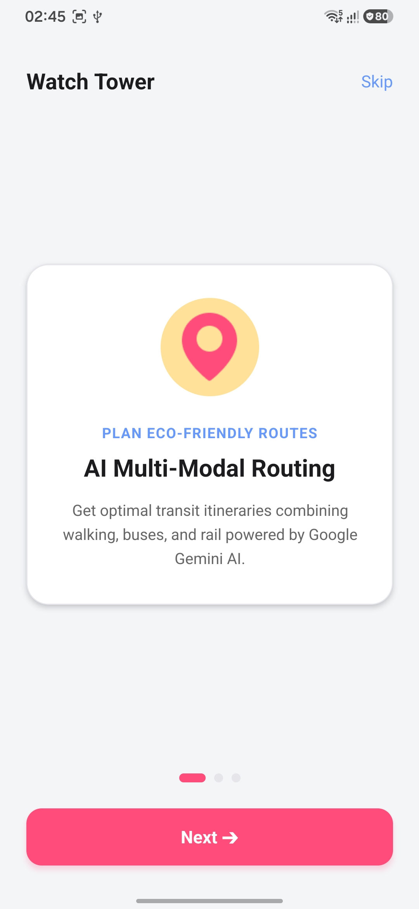
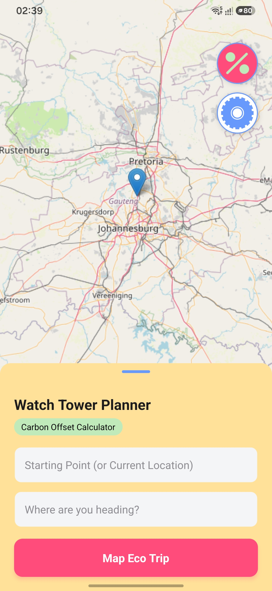
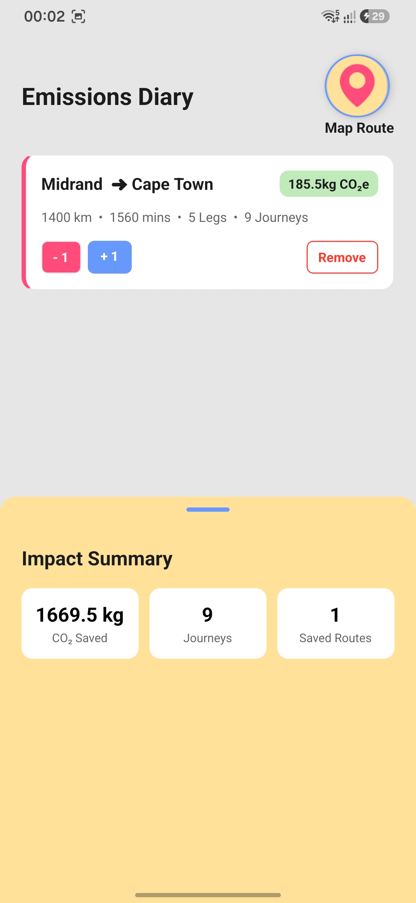
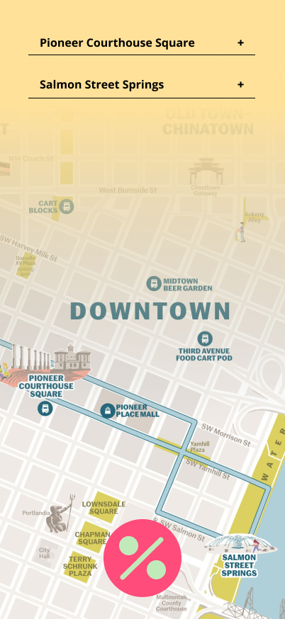
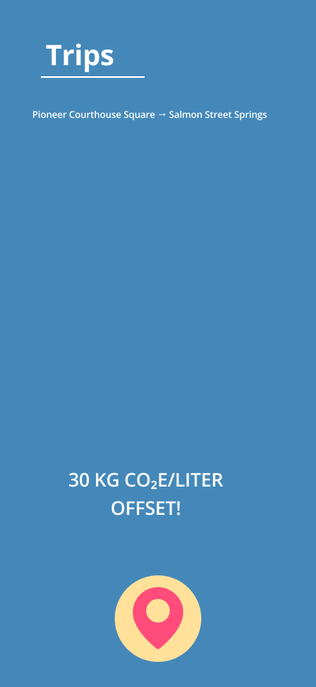
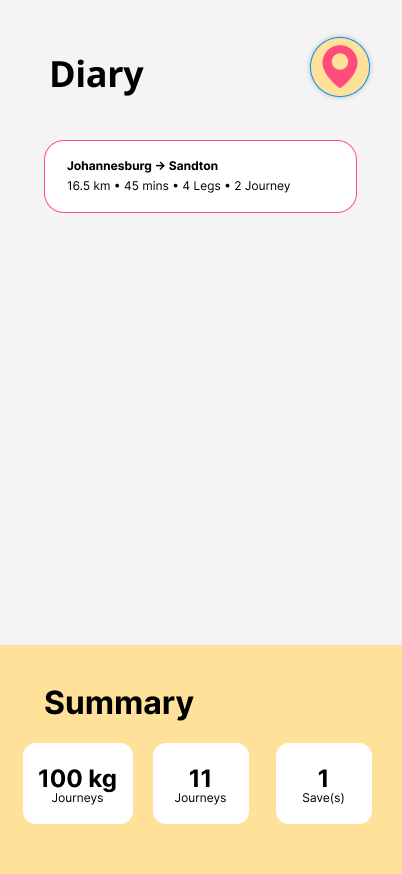

# Watch Tower

Watch Tower is an eco-conscious urbanist mobile application designed to simplify public transit navigation while empowering users to track and quantify their personal carbon footprint savings.

[Demostration Video](https://drive.google.com/file/d/1KSdd08vH4-dykg06mrcUb1szYeJYHjQN/view?usp=sharing)

---

## Table of Contents
- [Overview](#overview)
  - [Product Introduction](#product-introduction)
  - [Page Overview](#page-overview)
- [Technologies used](#technologies-used)
  - [Frontend](#frontend)
  - [Backend](#backend)
- [Contributers](#contributers)
- [Acknowledgment](#acknowledgment)

---

## Overview

Watch Tower bridges intelligent multi-modal transit planning with daily personal sustainability tracking. The application translates urban navigation into actionable carbon reduction metrics, turning everyday commutes into measurable environmental impact.

### Product Introduction
[Demostration Video](https://drive.google.com/file/d/1KSdd08vH4-dykg06mrcUb1szYeJYHjQN/view?usp=sharing)

* **The Problem:** Urban commuters often lack visibility into optimal public transit routes and have no clear way to measure the environmental impact of choosing eco-friendly transit options over single-occupancy gasoline vehicle driving. Traditional navigation apps focus solely on speed and distance without highlighting carbon savings or encouraging recurring sustainable commuting habits.
* **The Solution:** Watch Tower provides an integrated transit and carbon accountability platform. Powered by Google Gemini, the app generates structured multi-modal itineraries (walking, bus, rail, etc.) complete with step-by-step route breakdowns and real-time carbon offset estimates. Users can save these route plans to an interactive "Emissions Diary" and log repeat daily commutes with a single tap to visualize their cumulative CO₂ savings over time.

### Page Overview

* **Authentication (`UserAuth.jsx`):** Secure login and account registration interface powered by Firebase Auth, featuring input validation, error handling, and persistent user sessions.

* **Onboarding (`Onboarding.jsx`):** Button gated carousel containing app and pages overviews.

* **Route Planner & Map (`Mapping.jsx`):** Interactive map viewer utilizing Leaflet.js inside a WebView. Features location auto-detection, a collapsible bottom sheet for destination entry, Gemini-powered route generation, step-by-step itinerary leg breakdowns, and one-tap route saving to the user's database.

* **Emissions Diary (`History.jsx`):** A real-time dashboard displaying all saved route plans. Includes an aggregate impact summary bottom sheet showing cumulative CO₂ saved, total journeys completed, and total active routes.

---

## Technologies used

Watch Tower relies on a modular React Native architecture coupled with serverless cloud services and artificial intelligence to deliver real-time map rendering and route analysis.

### Frontend

* **Framework & Tooling:** React Native, Expo SDK
* **State & Gesture Management:** `react-native-gesture-handler`, `@gorhom/bottom-sheet`
* **Maps & Visualization:** `react-native-webview`, Leaflet.js, OpenStreetMap
* **Device Services:** `expo-location` for real-time geolocation retrieval
* **Design System & Palette:** Custom eco-urbanist palette featuring Pink CTA (`#FF4C7A`), Eco Mint (`#C1EABB`), Header Blue (`#6798FC`), and Surface Yellow (`#FFE199`)

### Backend

* **Authentication:** Firebase Auth initialized with `@react-native-async-storage/async-storage` for seamless session persistence across app reloads.
* **Database:** Google Cloud Firestore storing structured `userTrips` documents. Utilizes atomic `increment()` counters for journey logs and `serverTimestamp()` for sorting.
* **Artificial Intelligence:** Google Gemini API integration for structured transit routing, duration/distance estimation, and carbon offset calculations.
* **Storage:** Firebase Storage for hosting application media and assets.

---

## Visuals
### Mockups

### Wireframes
#### Planning

#### Final

--- 

## Contributers

Watch Tower is built and maintained by me with sporadic help people such as:
- Tsungai Katsuro - https://github.com/TsungaiKats 

---

## Acknowledgment

Special thanks to the open-source communities and platform creators that made Watch Tower possible:

* **OpenStreetMap & Leaflet.js** for providing accessible, open-source mapping tiles and rendering libraries.
* **Google Gemini API** for powering intelligent, structured transit parsing and carbon estimation.
* **Firebase & Expo Teams** for robust platform tools supporting React Native mobile development.